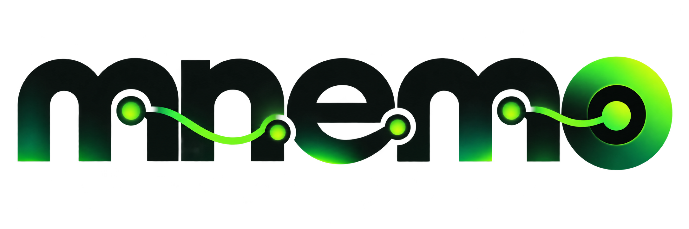

<div align="center">
  

  # MNEMO
  ### Deterministic Repository Intelligence, Graph-RAG AI & Simulation Engine
  *(Why The Code Is Like This · WTCLT Architecture)*

  <p align="center">
    <strong>Turn any Git repository into an interactive knowledge graph, multi-agent intelligence workspace, and grounded Graph-RAG AI assistant.</strong>
  </p>

  <p align="center">
    
    
    
    
    
  </p>
</div>

---

## Table of Contents
- [The Problem Statement & Core USP: Why MNEMO vs Generic AI Chat?](#the-problem-statement--core-usp-why-mnemo-vs-generic-ai-chat-chatgpt-claude-code)
- [Key Features](#key-features)
  - [1. Graph-RAG AI & Interactive Simulation](#1-graph-rag-ai--interactive-simulation)
  - [2. Persistent Repository Storage & Instant Fast-Load](#2-persistent-repository-storage--instant-fast-load)
  - [3. Deterministic Knowledge Graph](#3-deterministic-knowledge-graph)
  - [4. Multi-Agent Contributor Workflow](#4-multi-agent-contributor-workflow)
  - [5. Interactive Git History & Commit Wave](#5-interactive-git-history--commit-wave)
  - [6. Source Explorer & Rich Document Viewer](#6-source-explorer--rich-document-viewer)
  - [7. Optional Neo4j AuraDB Sync](#7-optional-neo4j-auradb-sync)
- [Architecture & System Design](#architecture--system-design)
- [Workspace Navigation](#workspace-navigation)
- [Quick Start](#quick-start)
  - [Prerequisites](#prerequisites)
  - [Installation](#installation)
  - [Running the Web Server](#running-the-web-server)
  - [CLI Mode](#cli-mode)
- [Configuration & Environment Variables](#configuration--environment-variables)
- [API Reference](#api-reference)
- [Testing](#testing)
- [Contributing & License](#contributing--license)

---

## The Problem Statement & Core USP: Why MNEMO vs Generic AI Chat (ChatGPT, Claude Code)?

### The Problem Statement (PS)
Current state-of-the-art coding assistants (such as ChatGPT, Claude Code, GitHub Copilot, and Cursor) are primarily **static text generators**. While they are proficient at writing boilerplate code, they fail completely at **software archaeology** and historical repository comprehension:

1. **Temporal Blindness**: Generic LLM chats only see a flat, static snapshot of files in the current workspace. They have zero awareness of the repository's evolution over weeks, months, or years.
2. **Hallucinated Rationale**: When you ask Claude or ChatGPT: *"Why is this auth middleware structured this way?"* or *"What breaking change forced this refactor?"*, the model cannot inspect past commits, PR discussions, or author decisions. Instead, it **hallucinates** plausible-sounding justifications.
3. **Naive Document Chunking**: Traditional RAG systems blindly slice files into arbitrary 500-token character chunks. They miss multi-file AST call graphs, class inheritance, symbol dependencies, and cross-language boundaries.
4. **No Ownership Provenance**: Generic chats cannot tell you which developer originally designed a module, who maintains it today, or how knowledge is siloed across the team.

---

### How MNEMO Tackles This (The Architectural Solution)

MNEMO was designed around the **WTCLT (Why The Code Is Like This)** architecture:

```
[GIT REPOSITORY] ──> [Deterministic Parsing] ──> [Dual Graph-RAG Engine] ──> [Grounded Intelligence]
  ├── Git Commits        ├── AST Symbol Extractor     ├── Inverted Entity Index     ├── Multi-Agent Personas
  ├── Diff Hunks         ├── Line-Hunk Correlator     │   (node_to_chunks)          ├── Blast Radius Simulator
  ├── PRs & Authors      ├── Decision Node Miner      ├── Cosine Vector Similarity  └── Evidence-Backed Answers
  └── File Trees         └── Module Topology          └── Bounded Context Window        (Zero Hallucination)
```

1. **Deterministic Graph Construction**: Before any AI prompt is constructed, MNEMO deterministically parses the code using Python's AST parser and conservative multi-language regex parsers (TypeScript, JS, Go, Rust, Java, C++). Nodes represent files, classes, functions, commits, contributors, and decisions, linked by typed edges (`DEFINES`, `CALLS`, `IMPORTS`, `MODIFIED_BY`, `MOTIVATED_BY`).
2. **Line-Range Hunk Correlation**: Every commit diff hunk is mapped directly to overlapping AST symbol line ranges. MNEMO knows with mathematical precision which commit touched which function.
3. **Inverted Entity-Chunk Index (`node_to_chunks`)**: Chunks in MNEMO are not arbitrary text blocks—they are first-class code symbols, architectural units, and commit decision records. The dual index allows instantaneous traversal from graph nodes to embedding chunks and vice versa.
4. **Virtual Contributor Personas**: Rather than a single generic chatbot, MNEMO spawns virtual personas mapped to real commit authors (Lead Architects, Backend Engineers, DevOps maintainers) with isolated ownership memory.
5. **Bounded Evidence Contract**: If historical evidence or call connections do not exist in the graph, MNEMO states it honestly rather than guessing.

---

### The Main USP (Unique Selling Proposition)

| Capability | Generic Chat (ChatGPT / Claude Code) | Traditional Code RAG (Copilot / Cursor) | **MNEMO** |
|---|---|---|---|
| **Temporal Lineage** | ❌ None (sees only flat snapshot) | ❌ None | **Full Git lineage from first commit to HEAD** |
| **Why It Changed (Rationale)** | ⚠️ Hallucinates speculative reasons | ❌ Unaware of commit history | **Bounded to exact commit diffs, PRs & decisions** |
| **Code Structure Understanding** | ⚠️ Blind token windows | ⚠️ Arbitrary text chunking | **Deterministic AST call graphs & module topology** |
| **Inverted Graph-RAG Index** | ❌ Plain text vectors | ⚠️ File-level vector search | **Bidirectional node-to-chunk graph index** |
| **Developer Personas** | ❌ Generic synthetic AI | ❌ None | **Multi-agent personas derived from real committers** |
| **Change Simulation & Blast Radius** | ❌ Cannot compute graph reachability | ❌ None | **Interactive blast radius simulation across dependencies** |
| **Zero-Dependency Core** | ❌ Cloud-locked SaaS | ❌ Cloud-locked | **100% Python standard library (no forced frameworks)** |
| **Snapshot Persistence** | ❌ Session wiped on tab close | ⚠️ Ephemeral local cache | **Local Disk Mirror + Vercel Blob Cloud Persistence** |

---

## Key Features

### 1. Graph-RAG AI & Interactive Simulation
- **Conversational Repository AI**: Ask any question about code rationale, system flow, architecture, or edge cases. Answers cite real files and commit hashes.
- **Scenario Simulator**: Simulate the impact, blast radius, and delivery risk of proposed code changes before writing a single line of code.
- **Interactive Scenarios**: Quick prompt scenario chips for instant queries (Core Architecture, Service Blast Radius, Contributor Ownership, Commit Lineage).
- **Multi-Tab Inspection**:
  - `AI Chat & Simulation`: Multi-turn conversational interface with route summaries and scope indicators.
  - `Orchestrator & Agents`: Live multi-agent reasoning trace breaking questions down by domain specialists.
  - `Routing Trace`: Visual traversal evidence from user query through graph nodes and contributor footprints.
  - `Findings & Code Chunks`: Direct inspection of retrieved Graph-RAG chunks with cosine similarity scoring.

### 2. Persistent Repository Storage & Instant Fast-Load
- **Dedicated Storage Hierarchy**: Ingested repositories are permanently saved in `storage/<repo_name>/`, containing:
  - `files/`: Complete local mirror of repository source files for offline inspection and syntax highlighting.
  - `graph/graph.json`: Serialized knowledge graph with all nodes and typed edges.
  - `commits/`: Full commit history, author metadata, and diff hunks.
  - `rag/graph_rag_embeddings.json`: Master vector embeddings file with deterministic hash indexes.
  - `metadata.json` & `inspection.json`: Repository stats, languages, and dependencies.
- **Zero Re-Ingestion Overhead**: Open any previously inspected repository instantly from the Intake Screen cards or the topbar modal without re-cloning or hitting GitHub API rate limits.
- **Vercel Blob Storage Cloud Sync**: Seamlessly back up and restore complete repository snapshots (graph nodes, RAG chunks, embeddings, commit history, and AI chats) directly to Vercel Blob Storage with private access and zero third-party packages.

### 3. Deterministic Knowledge Graph
- **Symbol Extraction**: Python AST parser extracts classes, functions, calls, and imports. Conservative multi-language regex parsers extract TypeScript, JavaScript, Go, Rust, Java, and C++ symbols.
- **Evidence Linking**: Commit hunks link directly to overlapping line ranges in tracked files and indexed symbols.
- **Decision Mining**: Intent-bearing commit messages (e.g., *refactor, fix, security, chore*) are converted into first-class `Decision` graph nodes.
- **Multi-View Graph Visualizer**: Interactive SVG/Canvas graph viewer supporting Evidence, Code Graph, Module Hierarchy, and High-Level Architecture views with zoom, pan, and dragging.

### 4. Multi-Agent Contributor Workflow
- **Contributor Agents**: Every author in repository history becomes a specialized contributor agent with bounded context (files touched, commits authored, pull requests merged).
- **Parallel Orchestrator**: Multi-agent coordinator delegates architectural and code questions to the specific agents who actually wrote and maintained that code.

### 5. Interactive Git History & Commit Wave
- **Wave Visualizer**: Dynamic animated commit density canvas illustrating contribution waves across the project's lifetime.
- **Delivery Signals**: Dedicated pull request cards with formatted statuses (`Merged`, `Open`, `Conflict`), branch refs, and GitHub push events.
- **Commit History & Timeline**: Search commits by hash, message, or author with an interactive timeline slider from the repository's initial commit to `HEAD`.

### 6. Source Explorer & Rich Document Viewer
- **File Tree**: Fast directory tree with tracked source file counts and language indicators.
- **Code Viewer**: Multi-tab editor with line numbering, syntax highlighting, explain file actions, copy triggers, and side-by-side Git diffs.
- **Markdown Documentation**: Auto-detects READMEs, contribution guides, and architectural design docs, rendering GitHub-flavored Markdown.

### 7. Optional Neo4j AuraDB Sync
- Mnemo operates 100% locally with zero external database dependencies.
- When configured, seamlessly persists and queries graph nodes (`Repository`, `File`, `Function`, `Commit`, `Contributor`, `Decision`) in Neo4j AuraDB with one click.

---

## Architecture & System Design

```
+-----------------------------------------------------------------------+
|                              MNEMO WEB UI                             |
|  [Dashboard] [Graph] [Code] [Contributors] [History] [Simulation] ... |
+-----------------------------------+-----------------------------------+
                                    | REST / SSE / WebSockets
+-----------------------------------v-----------------------------------+
|                        MNEMO FAST CORE SERVER                         |
|                             (mnemo/web.py)                            |
+------------------+------------------+------------------+--------------+
                   |                  |                  |
+------------------v---+      +-------v----------+  +----v-------------+
|    INGEST ENGINE     |      |  GRAPH-RAG & AI  |  |  LOCAL STORAGE   |
|   (mnemo/ingest.py)  |      |  (mnemo/ai.py)   |  | (mnemo/storage.py|
|  - Git CLI lineage   |      | - Vector index   |  | - files/ mirror  |
|  - AST symbols       |      | - Multi-agent    |  | - graph.json     |
|  - Diff correlation  |      |   orchestrator   |  | - master RAG     |
|  - Decision mining   |      | - Multi-provider |  |   embeddings     |
+----------------------+      +------------------+  +------------------+
                   |                  |                  |
+------------------v------------------v------------------v--------------+
|                     PORTABLE DETERMINISTIC GRAPH                      |
|                  (Nodes, Edges, Chunks, Embeddings)                  |
+-------------------------------------+---------------------------------+
                                      | (Optional Sync)
                         +------------v------------+
                         |      NEO4J AURADB       |
                         +-------------------------+
```

---

## Workspace Navigation

The workspace layout is structured into dedicated, task-focused tabs:

| Tab | Purpose |
|---|---|
| **Dashboard** | Repository snapshot hero, pulse metrics, contribution wave animation, latest changes, and coverage metrics. |
| **Graph** | Repository map visualizer with Evidence, Code Graph, Modules, and Architecture modes. |
| **Code** | Full source explorer with file tree, documentation cards, Monaco-style editor, commit diffs, and entity relationships. |
| **Contributors** | Parallel agent workflow graph and contributor file/commit ownership footprints. |
| **History** | Git track with summary statistics, branches, pull request status cards, push events, filterable commit logs, and interactive timeline slider. |
| **Ask** | Direct single-turn QA interface grounded in knowledge graph evidence. |
| **Simulation** | Interactive conversational Graph-RAG AI chat with multi-agent orchestration, route tracing, and chunk inspection. |
| **Compare** | Structural diff comparison between any two arbitrary tags, branches, or commits in repository history. |
| **Connections** | Live status and health checks for Neo4j AuraDB, AI providers (OpenRouter, Groq, NVIDIA NIM, OpenAI, Anthropic, Gemini, Ollama), and GitHub token configuration. |

---

## Quick Start

### Prerequisites
- **Python**: 3.11 or higher
- **Git**: Installed and accessible in your system `PATH`
- **Operating System**: macOS, Linux, or Windows

### Installation

Clone the repository and install dependencies in editable mode:

```bash
git clone https://github.com/Mohitsharma-2007/MNEMO.git
cd MNEMO

# Create and activate virtual environment
python3 -m venv .venv
source .venv/bin/activate  # On Windows: .venv\Scripts\activate

# Install dependencies
pip install -e .
```

### Running the Web Server

Launch the Mnemo web workspace:

```bash
python -m mnemo serve --host 127.0.0.1 --port 8000
```

Open your browser at **`http://127.0.0.1:8000`**. You can:
1. Ingest any public GitHub repository (e.g. `psf/requests`, `pallets/flask`).
2. Ingest any local directory path on your machine.
3. Open any previously saved repository snapshot directly from the **Previously Inspected Repositories** list.

### CLI Mode

Perform deterministic offline graph ingestion from the terminal:

```bash
# Ingest repository into a local graph JSON
python -m mnemo ingest /path/to/repo --output graph.json

# Query code rationale via CLI
python -m mnemo ask graph.json "Why was MAX_RETRY configured this way?"
```

---

## Configuration & Environment Variables

Copy the example configuration to `.env`:

```bash
cp .env.example .env
```

Key environment variables:

```ini
# Optional GitHub token to raise REST API rate limits
GITHUB_TOKEN=your_github_personal_access_token

# Optional Neo4j AuraDB Persistence
NEO4J_URI=neo4j+s://your-instance.databases.neo4j.io
NEO4J_USER=neo4j
NEO4J_PASSWORD=your_secure_password
NEO4J_DATABASE=neo4j

# AI Providers (Any or all can be supplied)
OPENROUTER_API_KEY=sk-or-v1-...
GROQ_API_KEY=gsk_...
NVIDIA_API_KEY=nvapi-...
OPENAI_API_KEY=sk-...
ANTHROPIC_API_KEY=sk-ant-...
GEMINI_API_KEY=AIzaSy...

# Storage Directory & Cloud Persistence
MNEMO_STORAGE_DIR=storage
BLOB_READ_WRITE_TOKEN=vercel_blob_rw_...
```

---

## API Reference

| Method | Endpoint | Description |
|---|---|---|
| `POST` | `/api/github/inspect` | Starts asynchronous ingestion of a GitHub or local repository. |
| `GET` | `/api/github/progress?job_id=<id>` | Polls live ingestion progress and stage percentages. |
| `GET` | `/api/github/progress/stream` | Server-Sent Events (SSE) stream for real-time progress. |
| `GET` | `/api/storage/repositories` | Lists all persistently saved repository snapshots. |
| `POST` | `/api/storage/open` | Instantly mounts a stored repository snapshot without re-ingestion. |
| `GET` | `/api/storage/vercel/status` | Returns Vercel Blob Storage connectivity and remote repository count. |
| `POST` | `/api/storage/vercel/save` | Uploads current repository artifacts and Graph-RAG chunks to Vercel Storage. |
| `POST` | `/api/storage/vercel/restore` | Downloads and loads a repository snapshot directly from Vercel Storage. |
| `POST` | `/api/simulation/query` | Executes Graph-RAG simulation and conversational AI synthesis. |
| `POST` | `/api/ai/chat` | Bounded evidence QA assistant query. |
| `GET` | `/api/ai/providers` | Discovers available AI providers, statuses, and live model catalogs. |
| `GET` | `/api/source?file=<path>` | Fetches tracked source code with line counts and syntax types. |
| `GET` | `/api/source/diff` | Returns side-by-side hunk diffs for specific files and commits. |
| `GET` | `/api/repository/documents` | Lists documentation files (READMEs, architectural specs). |
| `GET` | `/api/neo4j/status` | Verifies Neo4j AuraDB connectivity. |
| `POST` | `/api/neo4j/sync` | Synchronizes active deterministic graph into Neo4j AuraDB. |

---

## Testing

Run the comprehensive unit test suite:

```bash
python -m unittest discover -s tests -p "test_*.py"
```

All 44 core test suites validate:
- Git checkout and commit lineage parsing.
- Deterministic AST and multi-language symbol extraction.
- Graph-RAG chunking, deterministic cosine ranking, and vector persistence.
- Multi-agent orchestration and conversation synthesis.
- Web server endpoints, storage loading, and UI static handlers.

---

## Contributing & License

Contributions, feedback, and pull requests are welcome. Please ensure that all changes adhere to deterministic analysis constraints and that the test suite passes before submitting.

Distributed under the **MIT License**. See `LICENSE` for details.
